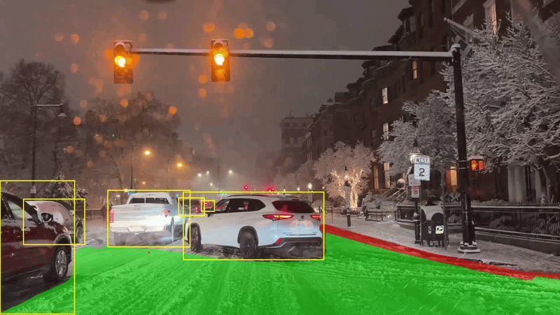
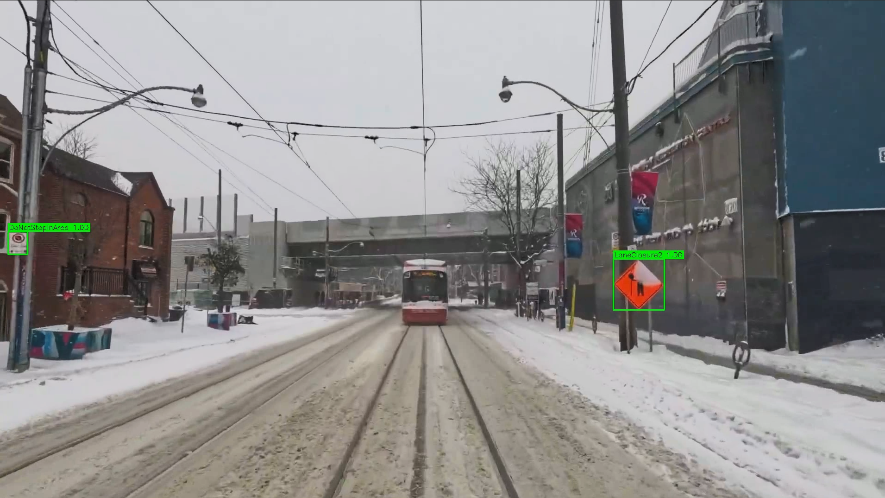
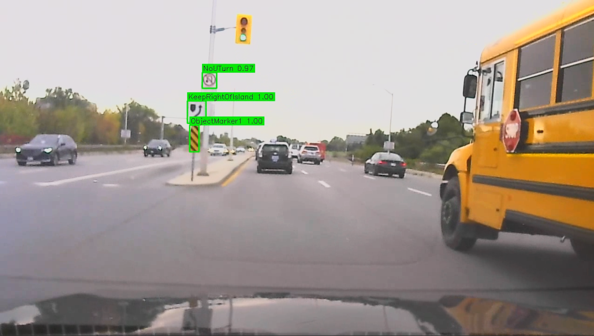

# CUVision: Autonomous Driving Perception Pipeline

Real-time road segmentation, lane detection, and traffic sign recognition from a single camera feed. It runs as a four-node ROS2 Jazzy pipeline, streams to a browser viewer, and can be driven live from the CARLA simulator.

This started as our Carleton University Software Engineering capstone. I was the perception lead, and the [My contributions](#my-contributions) section below spells out which parts are mine.

<!-- Replace with your own GIF or screenshot from docs/ -->




## What it does

Each frame goes through two models running side by side:

- **TwinLiteNetPlus** produces the drivable-area mask and lane lines in one pass.
- **A two-stage sign pipeline** finds signs with a single-class YOLO26n detector, then identifies each crop with a MobileNetV3-Small classifier trained on 252 sign classes.

The results are fused and shown in an MJPEG web viewer. Frames can come from CARLA or from a Simulink model over TCP.

```
Camera (Simulink/TCP or CARLA) ──> Road Segmentation (TwinLiteNetPlus)
                               ├──> Lane Line Detection (TwinLiteNetPlus)
                               └──> Traffic Sign Detection (YOLO26n + MobileNetV3)
                                        │
                                        v
                               ROS2 Fusion / MJPEG Web Viewer
```

## Results

All benchmarks use an RTX 4080 SUPER, FP16, 384x640 input.

**Speed against YOLOPX**

| Model                 | Params | Mean (ms) | FPS |
| --------------------- | ------ | --------- | --- |
| TwinLiteNetPlus-Large | 1.9M   | 3.37      | 297 |
| YOLOPX                | 33.1M  | 7.21      | 139 |

TwinLiteNetPlus is 2.14x faster with 17x fewer parameters.

**Accuracy on BDD100K validation (10K images)**

| Metric      | TLNP-Large | YOLOPX |
| ----------- | ---------- | ------ |
| DA mIoU     | 0.9291     | 0.9316 |
| DA Accuracy | 0.9752     | 0.9762 |
| LL IoU      | 0.3420     | 0.2716 |
| LL Accuracy | 0.8223     | 0.7968 |

It is within half a point of YOLOPX on drivable area and clearly ahead on lane lines (+26% relative IoU).

**Other numbers**

- Fine-tuning on snow scenes from BDD100K improved drivable-area mIoU by 5.17% and lane IoU by 5.93%.
- The sign classifier reaches up to 99.4% top-1 accuracy.
- The full ROS2 pipeline and the CARLA pipeline both sustain 15+ FPS end to end.

## Components

| Component       | Model                  | Params | Job                          |
| --------------- | ---------------------- | ------ | ---------------------------- |
| Segmentation    | TwinLiteNetPlus-Large  | 1.9M   | Drivable area and lane lines |
| Sign detector   | YOLO26n (single-class) | 2.6M   | Locates traffic signs        |
| Sign classifier | MobileNetV3-Small      | 2.5M   | Identifies 252 sign types    |
| ROS2 pipeline   | 4-node architecture    | n/a    | Fusion and web viewer        |
| CARLA pipeline  | All of the above       | n/a    | Simulator integration        |

## Quick start

### Install

```bash
conda create -n driving python=3.10 -y
conda activate driving
pip install -r requirements.txt
```

### Run the models on a video

```bash
# Road segmentation and lane lines
cd segmentation
python demo.py --source /path/to/video.mp4 --weight weights/large.pth --config large

# Two-stage sign detection
cd detection
python two_stage_pipeline.py
```

### Run in CARLA

```bash
cd carla
conda run -n carla python carla_pipeline.py --carla-host <WINDOWS_IP>
# then open http://localhost:8080
```

Full setup is in the [CARLA README](carla/README.md).

### Deploy on ROS2

```bash
source /opt/ros/jazzy/setup.bash
source ~/ros2_ws/install/setup.bash
ros2 launch driving_pipeline pipeline_launch.py
```

Full setup is in the [ROS2 README](ros2_pipeline/README.md).

## Hardware

| Component | Minimum               | Recommended                   |
| --------- | --------------------- | ----------------------------- |
| GPU       | NVIDIA GTX 1060 (6GB) | RTX 4080 or better            |
| VRAM      | 4 GB                  | 8+ GB                         |
| RAM       | 8 GB                  | 16+ GB                        |
| Storage   | 10 GB                 | 50+ GB (with BDD100K dataset) |

## Repository layout

```
cuvision-driving-perception/
├── segmentation/    TwinLiteNetPlus training, inference, lane splitting
├── detection/       Two-stage sign detector and classifier
├── ros2_pipeline/   ROS2 Jazzy package (nodes, configs, launch files)
├── carla/           CARLA 0.9.15 integration and browser viewer
├── ros2_original/   Earlier ROS2 implementation by a teammate (Omar)
├── scripts/         Speed, accuracy, and snow-subset benchmarks
├── docs/            Images and supporting material
└── requirements.txt
```

Each component folder has its own README with training and usage details.

## Datasets

- **[BDD100K](https://www.bdd100k.com/)** for segmentation training and evaluation. I used the drivable-area and lane annotations, plus the weather labels to build the snow subset.
- **[MTSD](https://www.mapillary.com/dataset/trafficsign)** for the sign models. The labels are collapsed to a single class for the Stage 1 detector, and PNG templates are used to train the Stage 2 classifier.

## My contributions

I led perception on a team project. My work:

- Set up and trained the road segmentation and lane detection models, including the snow fine-tuning and the benchmarks against YOLOPX.
- Built the two-stage traffic sign pipeline (detector and classifier).
- Set up CARLA and wrote the integration pipeline that feeds simulator frames through the models.

The base TwinLiteNetPlus architecture and training code come from the upstream repo credited below. The original ROS2 nodes in `ros2_original/` were written by a teammate.

## Acknowledgments

- [TwinLiteNetPlus](https://github.com/chiraqL/TwinLiteNetPlus) by chiraqL: base segmentation architecture and training code
- [Ultralytics](https://github.com/ultralytics/ultralytics): framework behind the sign detector
- [BDD100K](https://www.bdd100k.com/) (Yu et al., 2020) and [MTSD](https://www.mapillary.com/dataset/trafficsign) (Ertler et al., 2020): training data
- [YOLOPX](https://github.com/CAIC-AD/YOLOPv2): speed and accuracy baseline
- [CARLA](https://carla.org/) (Dosovitskiy et al., 2017): simulator
- [ROS2 Jazzy](https://docs.ros.org/en/jazzy/), [PyTorch](https://pytorch.org/), and [torchvision](https://pytorch.org/vision/)